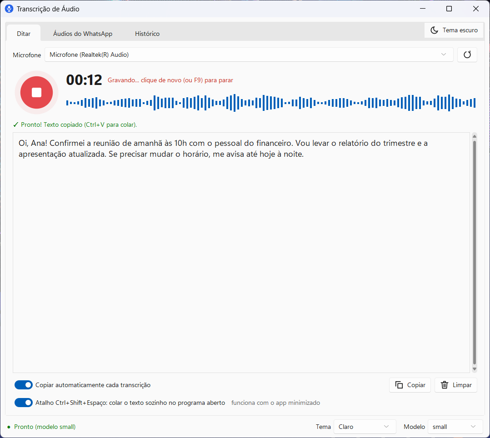
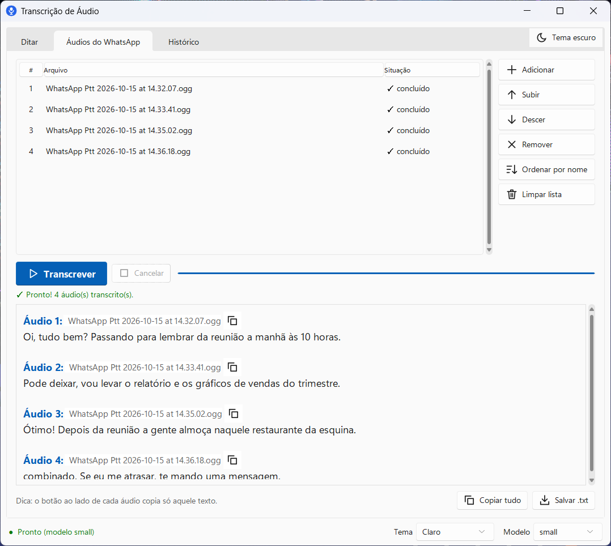
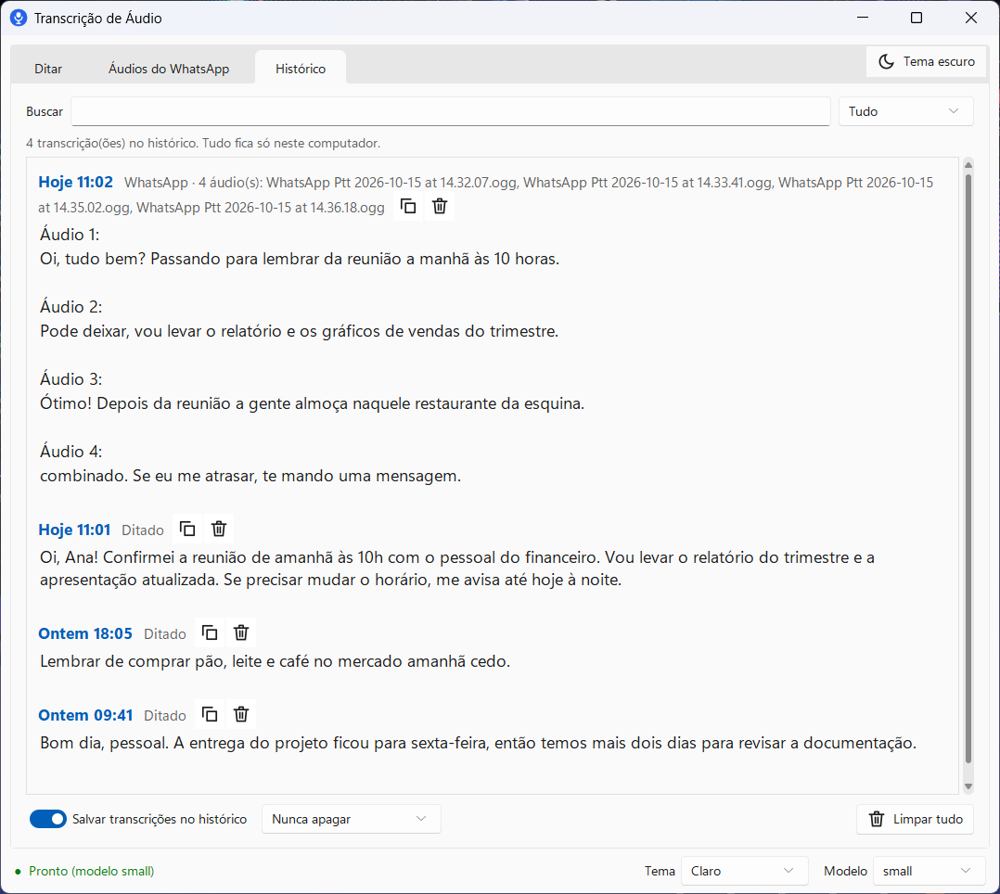
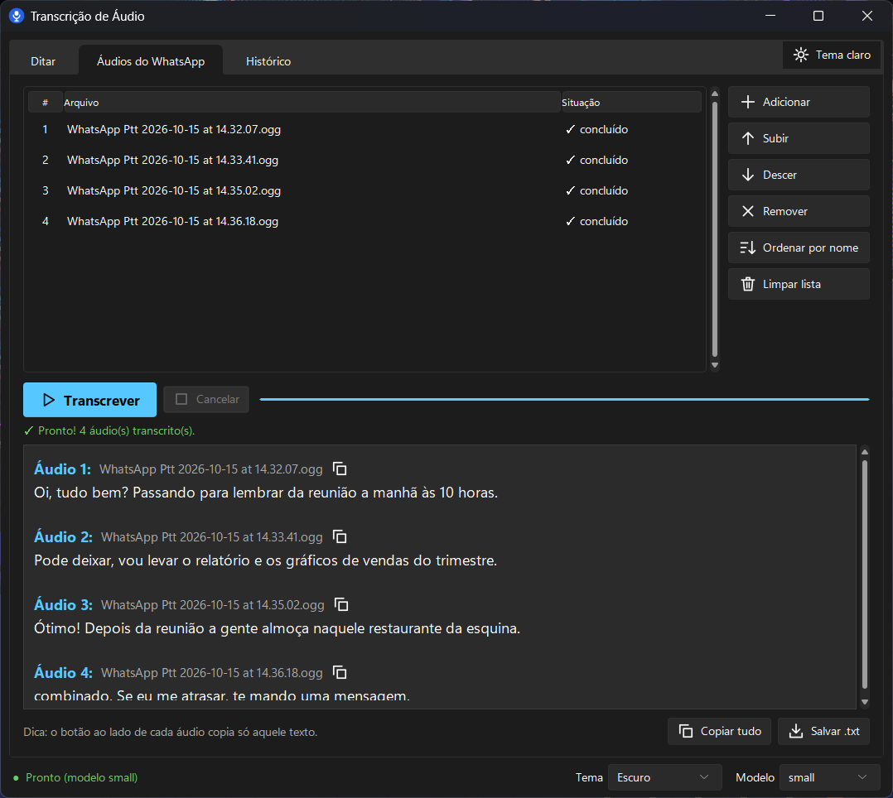
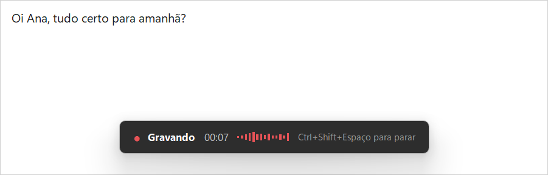

# Transcrição de Áudio

App de desktop para Windows que transcreve voz e áudios do WhatsApp em texto, em português, rodando o Whisper localmente — nada é enviado para a internet.

## Por que existe

Áudio de WhatsApp é prático para quem manda e chato para quem recebe: não dá para ler em silêncio, buscar depois nem copiar um trecho. Os serviços de transcrição online resolvem, mas exigem subir conversas pessoais para o servidor de alguém.

Este app faz a transcrição na própria máquina com o [faster-whisper](https://github.com/SYSTRAN/faster-whisper). Também serve para ditar: você aperta um atalho em qualquer programa, fala, e o texto é colado onde o cursor estava.

## Funcionalidades

- **Ditar pelo microfone**: grava na memória (não cria arquivo) e transcreve ao parar. Botão, F9 ou Ctrl+Shift+Espaço.
- **Ditado em qualquer programa**: com Ctrl+Shift+Espaço o app grava mesmo minimizado, mostra um aviso discreto no rodapé da tela e cola o texto na janela que estava ativa. Se você trocou de janela no meio, ele só copia, para não colar no lugar errado.
- **Áudios do WhatsApp em lote**: arraste vários `.ogg`/`.opus`/`.mp3`/`.m4a`/`.wav`/`.aac`/`.flac`, ajuste a ordem e transcreva. A saída sai no formato `Áudio 1: ... Áudio 2: ...`, com botão para copiar cada um ou tudo, e opção de salvar em `.txt`.
- **Histórico local**: as transcrições ficam num SQLite em `%APPDATA%\TranscricaoAudio`, com busca que ignora acentos, filtro por tipo e apagamento automático após 7, 30 ou 90 dias. Pode ser desligado.
- **Fica na bandeja**: fechar a janela deixa o app perto do relógio. Depois de um tempo sem uso o modelo sai da memória e volta sozinho na próxima transcrição.
- **Tema claro/escuro** no visual do Windows 11, acompanhando o sistema ou fixo.
- **Escolha do modelo** (`tiny` a `large-v3`) direto na barra de status.
- **Versão de linha de comando** para transcrever uma pasta inteira de uma vez.

## Screenshots

| Ditar | Áudios do WhatsApp |
|---|---|
|  |  |

| Histórico | Tema escuro |
|---|---|
|  |  |

Aviso flutuante durante o ditado pelo atalho global:



## Tecnologias

- Python 3.12
- [faster-whisper](https://github.com/SYSTRAN/faster-whisper) (CTranslate2, CPU, int8)
- Tkinter/ttk com o tema [Sun Valley](https://github.com/rdbende/Sun-Valley-ttk-theme) (`sv-ttk`)
- `sounddevice` para o microfone, `tkinterdnd2` para arrastar e soltar, `pystray` para o ícone da bandeja
- SQLite para o histórico
- API do Windows via `ctypes` (atalho global, colagem, instância única)

## Requisitos

- **Windows 10 ou 11.** O atalho global, a bandeja e a colagem automática usam APIs do Windows.
- **Python 3.12** do [python.org](https://www.python.org/downloads/), com o Tcl/Tk que vem no instalador padrão.
- Uns 2 GB de RAM livres para o modelo `small` (o padrão).
- Internet só na primeira execução, para baixar o modelo (cerca de 500 MB no `small`). Depois funciona offline.

## Instalação

```powershell
git clone https://github.com/Darlan0307/transcricao-audio.git
cd transcricao-audio

python -m venv .venv
.venv\Scripts\python -m pip install -r requirements.txt
```

As versões no `requirements.txt` estão fixadas de propósito: a `av` 16 ou mais nova quebra o faster-whisper.

## Como usar

Abrir o app (sem janela de terminal):

```powershell
.venv\Scripts\pythonw app.pyw
```

Na primeira vez a barra de status mostra "Baixando o modelo small..." e leva alguns minutos. O modelo fica no cache do Hugging Face (`%USERPROFILE%\.cache\huggingface`) e não é baixado de novo.

Criar atalhos na Área de Trabalho e no Menu Iniciar (não precisa de administrador):

```powershell
.venv\Scripts\python instalar_atalho.py            # cria
.venv\Scripts\python instalar_atalho.py --remover  # remove
```

Abrir junto com o Windows, já minimizado na bandeja (opcional):

```powershell
.venv\Scripts\python instalar_inicializacao.py            # ativa
.venv\Scripts\python instalar_inicializacao.py --remover  # desativa
```

### Linha de comando

Para transcrever uma pasta de áudios sem abrir a interface, coloque os arquivos em `audios/` e rode:

```powershell
.venv\Scripts\python transcrever_audios.py
```

O resultado vai para `transcricao_AAAA-MM-DD_HH-MM.txt`. A ordem é pelo nome do arquivo (ordenação natural, `audio-2` antes de `audio-10`), por um `audios/ordem.txt` com um nome por linha, ou por data com `--ordem data`. Outras opções: `--modelo` e `--pasta`.

## Configuração

Não há variáveis de ambiente nem arquivo `.env`. Tudo que o app guarda fica em `%APPDATA%\TranscricaoAudio`:

| Arquivo | Conteúdo |
|---|---|
| `config.json` | microfone, modelo, tema, opções de copiar/colar, tamanho da janela |
| `historico.db` | histórico das transcrições |
| `app.log` | log de erros (rotaciona em ~2 MB) |

Para começar do zero, feche o app e apague essa pasta.

## Estrutura

```
app.pyw                    interface (abas Ditar, Áudios do WhatsApp e Histórico)
transcricao.py             fila de transcrição e carregamento do modelo, sem interface
microfone.py               lista os microfones e grava em 16 kHz mono na memória
historico.py               histórico em SQLite
sistema.py                 integração com o Windows: atalho global, colar, bandeja
icones.py                  ícones desenhados com numpy, recoloridos conforme o tema
instalar_atalho.py         gera icone.ico e os atalhos do Menu Iniciar/Área de Trabalho
instalar_inicializacao.py  atalho na pasta de inicialização do Windows
transcrever_audios.py      versão de linha de comando
transcrever.bat            atalho para a versão de linha de comando (usa o python do PATH)
```

## Desenvolvimento

O projeto usa o [ruff](https://docs.astral.sh/ruff/) como linter, configurado no `pyproject.toml`:

```powershell
python -m pip install ruff
python -m ruff check .
```

## Próximos passos

- Unificar a versão de linha de comando com `transcricao.py` (hoje a lógica está duplicada e as extensões aceitas são diferentes)
- Testes automatizados para `transcricao.py` e `historico.py`
- Executável empacotado (PyInstaller) para quem não tem Python
- Escolha de idioma (hoje é fixo em português)
- Suporte a GPU (CUDA) para os modelos maiores

## Licença

[MIT](LICENSE)
